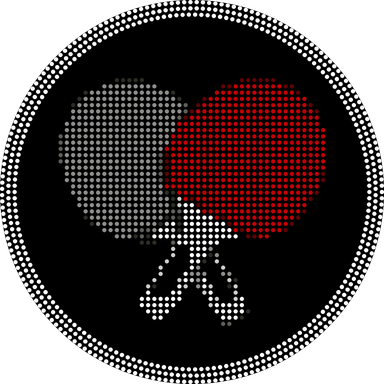

<p align="center">
  
</p>

<h1 align="center">black-mesa-tennis</h1>

<p align="center">
  An unofficial native <b>Android (ARM64)</b> port of <i>Rockstar Games presents Table Tennis</i> (Xbox 360),<br>
  built from the community static recompilation and tuned for Snapdragon handhelds such as the <b>AYN Thor</b>.
</p>

> [!IMPORTANT]
> **This repository contains no game code, data or assets, and never will.**
> You need **your own legally obtained retail copy** of the game, as a disc image (ISO) made from
> your own disc. The build scripts read that ISO on your own computer and turn it into an APK for
> **your own device**. Please don't ask for, link to or share ISOs, and **don't share the APK you
> build**: it contains data from your copy of the game. This project doesn't support piracy in
> any form.

> [!NOTE]
> **Upfront: I didn't write this. Claude, Anthropic's AI, did.** Nearly all of the code here was
> written by AI. See [How this was made](#how-this-was-made) for exactly who did what.

---

## Contents
- [How this was made](#how-this-was-made)
- [Status](#status)
- [What you need](#what-you-need)
- [Building the APK](#building-the-apk)
- [Installing and first launch](#installing-and-first-launch)
- [Recommended settings](#recommended-settings)
- [Settings guide (what each option does)](#settings-guide)
- [Controls](#controls)
- [Known issues](#known-issues)
- [Reporting problems](#reporting-problems)
- [Repository layout](#repository-layout)
- [Credits and license](#credits-and-license)

## How this was made

This project was built with AI, and I want to be completely clear about that.

**I'm not a programmer.** Nearly all of the code in this repository was written by
[Claude](https://www.anthropic.com/claude), an AI model made by Anthropic. Over about two weeks
(late October to mid-November 2026) Claude went from an empty repository to build v104, across
more than 130 commits. Every one of those commits is authored by Claude, so the history shows
exactly what it wrote and when.

### What Claude did
- **Wrote the code:** the stage 1 and stage 2 build scripts, the Windows installer, the patches
  that make the ReXGlue SDK run on Android's Vulkan drivers, the game-specific patches (such as
  turning off the game's MSAA and calming its GPU-wait loop), and the whole Android app, including
  the launcher, settings, driver import, log export and thread monitor.
- **Did the performance work:** added the profiler and frame-time logging, read the logs I sent
  back, worked out where the bottlenecks were, and took rallies on my AYN Thor from about 20 FPS
  to a steady 60.
- **Did the research:** read the upstream projects (the PC recompilation, ReXGlue, the MCLA
  Android port and other recompilation ports) to work out how to combine them and what they did
  better, and tracked down known upstream issues.
- **Wrote the docs:** this README, [docs/BUILDING.md](docs/BUILDING.md),
  [docs/DEVLOG.md](docs/DEVLOG.md), [HANDOFF.md](HANDOFF.md), and the licensing notices.

### The full development log
Every testing round, from the first fixes through v104, is written up in
**[docs/DEVLOG.md](docs/DEVLOG.md)**. For each round it covers what we tried, what the logs
showed, what we concluded, and what changed, plus a list of the ideas that didn't help and the
measurements behind each one.

### What I did
- **Had the idea and set the direction:** porting the PC recompilation to Android so it runs
  natively on my AYN Thor, plus what the app should do and what was worth chasing.
- **Ran every build and tested every one on real hardware.** Claude can't run the Android
  toolchain or touch a device, so every build was compiled on my PC from my own disc image and
  played on my own devices. Nothing here was verified any other way.
- **Reported back:** after each build I sent the logs, screenshots and FPS numbers, and described
  what looked or felt wrong.
- **Made the calls:** the look of the app and its logo, which settings to keep or drop, and the
  trade-offs. For example, I chose to keep the original visuals and shadows instead of trading
  them for frame rate.
- **Decide what ships.** I own the repository and choose what goes in it.

### What that means for you
- The code wasn't written or reviewed by an experienced developer, so expect rough edges and
  read it with that in mind. Issues and fixes are welcome; I'll keep feeding them back to Claude.
- The real heavy lifting was done by the people credited [below](#credits-and-license). This
  port stands on their recompilation, SDK and Android work.

## Status

**Playable, and at a steady 60 FPS on the AYN Thor.** All numbers below come from the app's own
logs during exhibition matches, on the current build unless a row names an older one. Settings
not listed in a row were **720p, Shaders: Wait, Hidden passes: Skipped**.

### Tested devices

| Device | Chip (GPU) | GPU driver | Other settings | Result |
|---|---|---|---|---|
| **AYN Thor** (reference) | Snapdragon 8 Gen 2 (Adreno 740) | Turnip Gen8 V39 | FXAA, Frame rate 60 | **60 FPS** in rallies (98% of a 6-minute session); menus 60. Graphics chip ~82% busy at 680 MHz. |
| **AYN Thor** | same | Turnip Gen8 V38 | FXAA, Frame rate **40** (build v79) | Steady 40 FPS on the 120 Hz screen, at a much lower load (emulator GPU thread ~25% of a CPU core instead of ~31% at Frame rate 60). Not re-measured since the v85–v94 speed-ups, which only lower it further. |
| **Sony Xperia 1 V** | Snapdragon 8 Gen 2 (Adreno 740) | Turnip Gen8 V39 | AA Off, Frame rate 60 (build v89) | **~60 FPS** over an 8-minute session (95% of it at 60), even after the phone lowered its CPU clock to stay cool (2.8 → 1.4 GHz). Some menu flicker. Needs a controller. |
| **Retroid Pocket Duo** | Dragonwing Q-7790 (Adreno 722) | **System (Qualcomm)** | FXAA, Frame rate 60 | **~45–52 FPS** in matches; menus 60. A short pause (~0.3 s) as each match starts, as on the Thor; the first launch also stutters while graphics programs are prepared and saved. With Frame rate 40, matches drop to ~22 FPS (use 60). With the current build, the Turnip drivers tried (Turnip-Duo v5.1, Gen8 V38) crash at the first serve; an older build ran on Turnip at only ~20–25 FPS. |
| Xiaomi Mi Mix 3 | Snapdragon 845 (Adreno 630) | — | — | Not tested. Installs (Android 10), but much less powerful; expect it to be too slow. |

Other Android devices with a recent Adreno GPU may work; reports are welcome (see
[Reporting problems](#reporting-problems)).

How 60 FPS was reached on the Thor (rallies, settings as in the first row; each step is
described in [docs/DEVLOG.md](docs/DEVLOG.md)):

| Build | Change | Rallies |
|---|---|---|
| v83 | Before this round | ~43–46 FPS, graphics chip 99% busy |
| v85 | Uploads no longer restart the GPU's render pass (256 → 68 restarts per frame) | ~52 FPS |
| v88 | Skips copying two depth buffers that are already skipped elsewhere | ~55 FPS |
| v90 | Finished images go straight into textures in one copy | **60 FPS**, chip ~96% busy |
| v92–v94 | The same for the blur and depth images | 60 FPS, chip ~81–83% busy |

## What you need

**Game**
- Your own retail **Xbox 360** disc image (`.iso`) of *Rockstar Games presents Table Tennis*,
  **USA or Europe** release (Title ID `545407DF`). The ISO is checked before anything is built,
  and other versions are rejected. It is only ever read, never modified.

**A computer to build on**
- **Windows 10/11 with WSL2** (Ubuntu 24.04), or Ubuntu 24.04 directly.
- An internet connection for the first build (it downloads the Android SDK/NDK and the
  open-source projects listed under [Credits](#credits-and-license)).
- Plenty of free disk space (20 GB or more is comfortable) and 1–2 hours for the first build.

**A device to play on**
- Android 10 or newer, ARM64, with Vulkan.
- Developed and tuned on the AYN Thor (Snapdragon 8 Gen 2). A controller is required (built-in
  controls on handhelds work).
- On Snapdragon 8 Gen 2 devices: a **Turnip** GPU driver package (see
  [Recommended settings](#recommended-settings)). On other chips, start with the system driver.

## Building the APK

### Easy way: the Windows installer

1. On this page, **Code → Download ZIP**, and unzip it anywhere.
2. Double-click **`Install-Table-Tennis.cmd`**. Use the arrow keys or mouse to move, Enter to
   select, and Esc to quit.
3. If WSL/Ubuntu isn't installed yet, select **Install Ubuntu (WSL)** (asks for administrator
   permission). Restart if Windows asks, finish Ubuntu's first-time setup (user name and
   password), and double-click the installer again.
4. **Game disc** → pick **your own ISO**, then **Build APK**. The installer installs the build tools, gets
   the latest version, checks your ISO, builds everything (1–2 hours the first time), and
   puts `TableTennis.apk` in your **Downloads** folder (**Open APK folder** shows it).

Run it again whenever you want the latest version. It remembers your ISO and skips finished
steps, so updates take minutes.

### Manual way (any OS with Ubuntu 24.04)

Details and troubleshooting are in [docs/BUILDING.md](docs/BUILDING.md):

1. **Windows only:** install WSL with Ubuntu. In an *administrator* PowerShell:
   `wsl --install -d Ubuntu-24.04`, reboot, and pick a user name and password.
2. In the **Ubuntu** window, get this repository:
   ```bash
   git clone https://github.com/henroids/black-mesa-tennis ~/black-mesa-tennis
   ```
3. **Stage 1 (once):** point it at your ISO. A Windows path like `C:\Games\TableTennis.iso`
   becomes `/mnt/c/Games/TableTennis.iso`. Keep the quotes:
   ```bash
   bash ~/black-mesa-tennis/stage1/tt_android_stage1.sh "/mnt/c/Games/TableTennis.iso"
   ```
   This sets up the toolchain, checks your ISO and recompiles the game code (1–2 hours).
4. **Stage 2 (every time you update):**
   ```bash
   cd ~/black-mesa-tennis && git pull && bash stage2/tt_android_stage2.sh
   ```
   The finished `TableTennis.apk` is copied to your Windows **Downloads** folder.

If a stage fails, it says so and leaves a log zip (`~/tt-android/tt-stage1-logs.zip` or
`tt-stage2-logs.zip`). Those contain build logs only, no game files.

## Installing and first launch

1. Copy `TableTennis.apk` to your device and install it (allow installs from your file manager
   if Android asks).
2. Open **Table Tennis**.
3. **Game disc → Choose**, and pick your ISO on the device. It is copied into the app's own folder
   once (keep the screen on until it says *Disc ready*).
4. *(Snapdragon 8 Gen 2 devices)* **Import driver**, pick a Turnip driver package (`.zip` /
   `.adpkg`), and select it under **GPU driver**. On other chips, try the system driver first.
5. Choose **Play**. The first time you visit each screen, there's a short stutter while shaders
   are prepared. They're kept for later sessions, so it settles down after one pass through the
   menus.

## Recommended settings

| Setting | Recommended | Notes |
|---|---|---|
| Resolution | **720p** | The game's native resolution |
| Anti-aliasing | **FXAA** | The Thor holds 60 FPS with FXAA on. *Off* shows more jagged edges and saves a little GPU work |
| Frame rate | **60 FPS** | The game's own rate. *40* for lower load and heat on 120 Hz screens (not on the Retroid Pocket Duo, see below) |
| Shaders | **Wait** | No missing objects; brief stutter on new screens only |
| GPU driver | **Snapdragon 8 Gen 2:** Turnip Gen8 V39 (V38 also fine) · **other chips:** System | Turnip builds from [StevenMXZ/Adreno-Tools-Drivers](https://github.com/StevenMXZ/Adreno-Tools-Drivers/releases). On the Retroid Pocket Duo (Adreno 722) the Turnip builds tried crash with the current build; its system driver works and is faster |
| Hidden passes | **Skipped (faster)** | Switch to *Drawn* if something looks wrong (see below) |
| Performance log | Off for normal play, **On** when reporting a problem | |

## Settings guide

What each option does. Frame rates are from the AYN Thor during rallies, compared with the
recommended settings (720p, FXAA, Frame rate 60, Turnip Gen8 V39, Hidden passes Skipped):

| Setting | Options | Effect on playability and frame rate |
|---|---|---|
| **Resolution** | 720p · 1440p (2×) | 1440p renders at twice the width and height: sharper, but much heavier, so expect a large FPS drop. |
| **Anti-aliasing** | Off · FXAA · FXAA (extreme) | Edge smoothing applied to the final image. Before the game reached 60 on the Thor, *Off* was worth about +1.3 FPS (not re-measured since). *Extreme* is smoother and a little heavier than FXAA. |
| **Frame rate** | 60 FPS · 40 FPS · 30 FPS · Uncapped | **60** is the game's own rate (a steady 60 on the Thor). **40** holds a steady 40 and switches the screen to 120 Hz, where every frame is shown for exactly the same time; it needs a 120 Hz screen and lowers load and heat. On the Retroid Pocket Duo it currently slows matches to ~22 FPS, so use 60 there. **30** caps at 30 for the lowest load. *Uncapped* is for testing only. |
| **Show FPS** | Off · On | Small FPS counter in the corner. No real cost. |
| **Shaders** | Async · Wait | *Wait*: everything is drawn correctly, with a brief stutter the first time a screen appears. *Async*: fewer stutters, but objects can pop in for a moment. |
| **GPU driver** | System · imported drivers | On the Thor, Turnip Gen8 V38/V39 are the fastest; Qualcomm's own driver measured much slower there in early builds (~25 FPS) with graphical errors. On the Retroid Pocket Duo it's the other way round: the system driver is the one that works (the Turnip builds tried crash at the first serve). |
| **Hidden passes** | Skipped · Drawn | *Skipped* leaves out rendering work that had no visible effect in testing and copies finished images straight into textures. Over several builds these shortcuts took Thor rallies from around 40 FPS to 60 (not measured as one on/off comparison); *Drawn* turns them all off. It was checked in a few venues and modes only, so if anything looks wrong, set **Drawn** and compare, and please report it. |
| **Performance log** | Off · On | Records a performance profile for problem reports. Leave it off for normal play. |

Always on (not settings): single-sample rendering instead of the game's 4× MSAA (the biggest single
speed-up), a calmer wait for the graphics chip (the game no longer keeps a CPU core spinning, which
lowers CPU load and heat), a stereo sound mix made for the device's speakers (clearer hits), every game frame shown on
screen, and a set of emulator fixes listed at the top of
[`stage2/native/patch_sdk_vulkan_fixes.py`](stage2/native/patch_sdk_vulkan_fixes.py).

## Controls

The game uses a controller, mapped like an Xbox 360 pad. Extra shortcuts while playing:

| Buttons | Action |
|---|---|
| **Back** (tap), or **Select + Start** | Return-to-start-screen pop-up (D-pad to choose, A to confirm, B to keep playing) |
| **L3 + R3** (press both sticks) | Screenshot, saved to `Pictures/TableTennis` with the date and time in the name |
| **Select** | The game's own camera button |

## Known issues

- **60 FPS needs Hidden passes: Skipped** (the default) and a chip like the Thor's. Slower chips
  run below 60 (Retroid Pocket Duo: ~45–52 FPS in matches).
- **Brief stutters the first time each screen loads** (shader preparation; cached afterwards).
- **Retroid Pocket Duo:** use the system driver and Frame rate 60. The first launch stutters
  while the driver prepares graphics programs; they're saved, so later launches are smooth apart
  from a short pause as each match loads. The screen sometimes stays black when the main menu
  appears; this is being looked into.
- **Flicker when something interrupts the game:** rotating the device, pulling down the
  notification shade or switching apps can make the picture flicker for a moment. Menus can also
  flicker now and then. Normal play isn't affected.
- *Hidden passes: Skipped* has only been checked in a few venues and modes. If something looks
  off, try *Drawn*.

## Reporting problems

Open an issue with:
1. what happened and where (venue, characters, mode), plus a screenshot (L3 + R3);
2. the log zip from the start screen: **Performance log → On**, reproduce, then **Export logs**.
   It contains logs and a device report only, no game files.

Please don't attach ISOs, APKs or other game files.

## Repository layout

| Path | What it is |
|---|---|
| `stage1/` | One-time setup: toolchain, ISO check, game recompilation |
| `stage2/` | Builds the APK: emulator fixes (`native/`), the Android app and launcher (`app/`) |
| `Install-Table-Tennis.cmd`, `tools/installer/` | Windows installer: your ISO in, APK out |
| `tools/use_version.sh` | Switch to an earlier build (`bash tools/use_version.sh 61`) |
| `assets/` | Images for this README (original artwork, no game assets) |
| `docs/BUILDING.md` | Detailed build steps, updating, troubleshooting |
| `docs/DEVLOG.md` | Development log: every testing round, its data and conclusion |
| `HANDOFF.md` | Developer notes: every change, what it measured, current bottleneck |
| `NOTICE.md`, `LICENSE`, `licenses/` | Credits, license, and third-party license texts |

## Credits and license

Built on the work of:
- **[Table-Tennis-Rockstar-PC](https://github.com/davidptrssvea/Table-Tennis-Rockstar-PC)** by davidptrssvea: the PC static recompilation this port is based on (MIT).
- **[ReXGlue SDK](https://github.com/rexglue/rexglue-sdk)**: the recompiler and runtime (derived from the Xenia project).
- **[MCLA Android port](https://github.com/gabrielbskk/mcla-recomp-android-g)**: Android build layout and custom driver loading (GPL-3.0).
- **[libadrenotools](https://github.com/bylaws/libadrenotools)**, **SDL3**, and the **GamePocket** font (SIL OFL).

This repository is distributed under the **GPL-3.0** ([LICENSE](LICENSE)); details in [NOTICE.md](NOTICE.md).

*Rockstar Games presents Table Tennis* is a trademark of its respective owners. This is an
unofficial fan project for personal use, not affiliated with or endorsed by Rockstar Games,
Take-Two Interactive or Microsoft.
